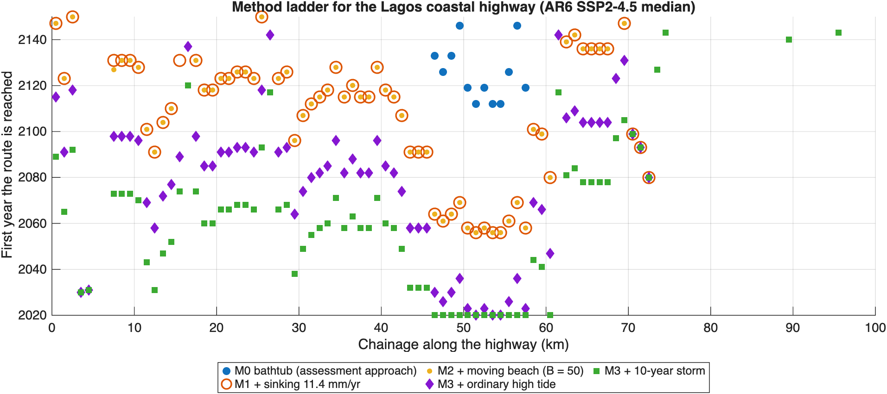
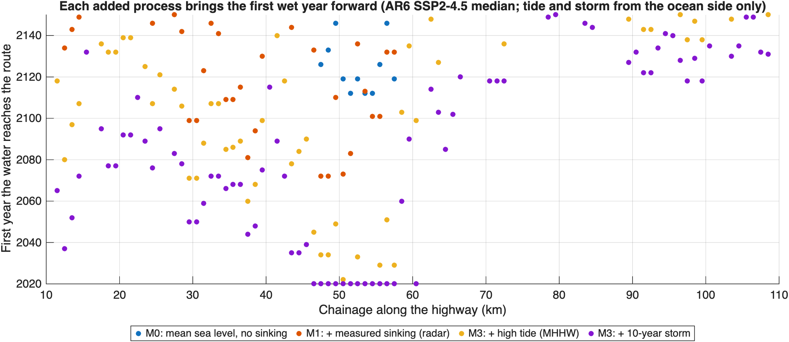
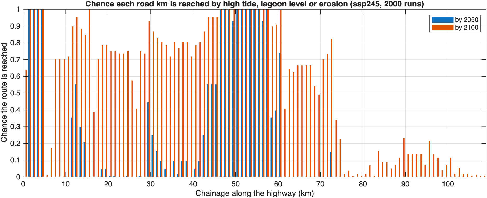
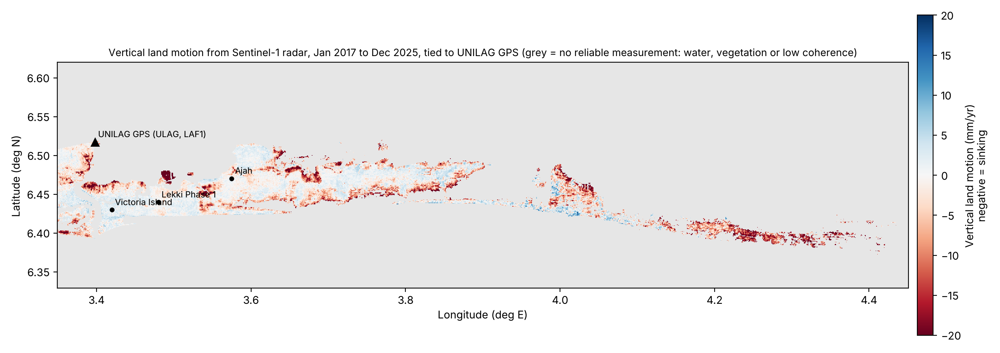
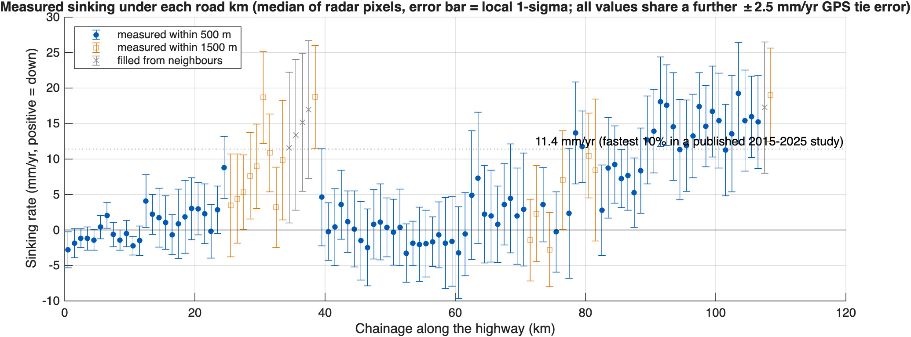

# Beyond the Bathtub: Coastal Risk for the Lagos Coastal Infrastructure Corridor

MATLAB and Simulink project for the MathWorks Global Student Challenge 2026
(Sustainability and Renewable Energy: *Coastline Prediction using Existing Climate Change Models*).

**Status:** land sinking is measured with our own Sentinel-1 radar processing (2017-2025, tied to GPS; see `insar/README_insar.md`) and applied to every elevation cell at its own rate. Still to add: own satellite shoreline positions, a hindcast test of the shoreline model, and elevation error in the uncertainty runs.

## Key findings

1. The highway assessment's bathtub screening (M0) finds no road km reached by the sea before 2100 under the IPCC AR6 median (SSP2-4.5). The same elevation data, with each missing process added one at a time, gives a very different answer: 30 of 109 road km reached by the ordinary high tide by 2100, and 49 km by a 10-year storm.
2. Our own radar measurements show the land under the route sinking by 4.4 mm/yr at the median, and by 16 mm/yr or more along its fastest 10%. Fill on the lagoon edges sinks 15 to 30 mm/yr. Measured sinking alone (M1) brings the first road km forward from 2112 to 2072 and puts 8 km under the mean sea level by 2100.
3. Sinking has to be applied point by point. Giving each road km one average rate finds only 3 km by 2100 instead of 8, because water reaches the road through the low spots that sink fastest.
4. About 3 km of the route (near km 50 to 54, Orimedu) crosses tidal wetland that is below today's high tide. These low channels are visible on satellite imagery.
5. Shoreline erosion alone reaches only about 3 road km by 2100. Where it does matter (CH 3+800), the model reproduces the assessment's own forecast. At CH 33+600 to 37+500 the assessment's forecast does not follow from its own measured rate.
6. In 2000 Monte Carlo runs the sinking error ranks above the sea-level percentile and the Bruun factor. Most of that error is the tie to GPS, because the only Lagos GPS records with public data end in 2013. A permanent GPS station on the corridor would cut the largest uncertainty in this result.

## Question

The environmental impact assessments for Sections 1 and 2 of the Lagos-Calabar Coastal Highway
(Federal Ministry of Works, 2024; km 0 to 47.5 and km 47.5 to 104) both state that a 0.5 m water
level rise "will not affect" the road (Section 1 p. 4-77, Section 2 p. 4-95), using a bathtub-style
screening tool. This project compares four methods
on the same corridor, each adding one process:

| Method | Includes |
| --- | --- |
| M0 Bathtub | Sea-level rise on the elevation model, connected to the sea |
| M1 Sinking land | M0 plus vertical land motion |
| M2 Moving beach | M1 plus shoreline retreat from a Simulink shoreline model driven by the assessments' measured rates (not yet calibrated or hindcast-tested) |
| M3 Extreme water | M2 plus tide and storm surge return levels |

For each 1 km segment of the road, the project reports the first year of impact under each
method and the gap between them. OpenStreetMap does not yet map the whole road, so results are
also reported for a coastal corridor (land within 2 km of the ocean, in 1 km alongshore strips)
that covers the full 104 km.

## Results

All results below use the IPCC AR6 projection for the Lagos tide gauge (PSMSL 162), the 109 road km mapped in OpenStreetMap, and the 10% rule (a km is reached when at least 100 m of it is under water or behind the shoreline).

### Method ladder (SSP2-4.5 median, measured sinking, Bruun factor 50)

| Method | Today (2020) | By 2030 | By 2050 | By 2100 | First year |
| --- | ---: | ---: | ---: | ---: | ---: |
| M0 bathtub (assessment approach) | 0 | 0 | 0 | 0 | 2112 |
| M1 + measured sinking (radar) | 0 | 0 | 0 | 8 | 2072 |
| M2 + moving beach | 0 | 1 | 2 | 11 | 2030 |
| M3 + ordinary high tide | 3 | 7 | 13 | 30 | 2020 |
| M3 + 10-year storm | 13 | 14 | 23 | 49 | 2020 |

Values are road km reached (out of 109). Each row includes everything in the rows above it. M0 uses no sinking.

### Measured sinking compared with uniform rates (M1 and M3 without erosion, SSP2-4.5 median, road km reached by 2100)

| Sinking | Mean sea level (M1) | High tide | 10-year storm | 100-year storm |
| --- | ---: | ---: | ---: | ---: |
| none | 0 | 13 | 24 | 31 |
| uniform 5 mm/yr | 12 | 22 | 50 | 57 |
| uniform 11.4 mm/yr (fastest 10% in a published 2015-2025 study) | 22 | 55 | 65 | 66 |
| uniform 34 mm/yr (published lower bound for Lekki and Victoria Island) | 71 | 94 | 109 | 109 |
| **measured by radar, cell by cell** | **8** | **27** | **46** | **50** |

Under SSP5-8.5 the measured case gives 14, 36, 51 and 56 km. About three quarters of the land cells have no radar pixel within 1.5 km; filling them with a smooth regional average, the whole-map median or the nearest pixel gives 8, 8 and 10 km for M1 and the same 27 and 46 km for high tide and 10-year storm, so this choice hardly matters for the road. Before this full run, the method was checked: with one uniform rate everywhere, the cell-by-cell code gives the same result as the faster flood-level map (0 vs 0 km at 0 mm/yr, 24 vs 22 km at 11.4 mm/yr; the small difference comes from the map's 5 cm steps).

### Erosion alone (Simulink shoreline model)

The assessments give measured shoreline change rates (end point rates, 1984 or 1986 to 2024) for 103 of the 109 road km. Run forward in the Simulink model `shoreline_model.slx`:

| Scenario | Bruun factor (m per m) | Road km reached by 2050 | By 2100 | Median retreat by 2100 (m) |
| --- | ---: | ---: | ---: | ---: |
| SSP2-4.5 | 0 | 2 | 3 | 34 |
| SSP2-4.5 | 50 | 2 | 3 | 48 |
| SSP2-4.5 | 100 | 2 | 3 | 61 |
| SSP5-8.5 | 0 | 2 | 3 | 34 |
| SSP5-8.5 | 50 | 2 | 3 | 58 |
| SSP5-8.5 | 100 | 2 | 3 | 81 |

Erosion on its own reaches only the few km where the beach is already close to the route.

### Uncertainty (2000 Monte Carlo runs per scenario)

Each run draws a sea-level percentile (5th to 95th), an error on the radar sinking map (a GPS tie error with standard deviation 2.5 mm/yr, plus the local error of each cell) and a Bruun factor (0 to 100). Flooding is run on the whole elevation model for 2050 and 2100 and combined with the high tide, the lagoon level and erosion.

| Scenario | Road km reached by 2050, median (5 to 95%) | By 2100, median (5 to 95%) | Main driver |
| --- | --- | --- | --- |
| SSP2-4.5 | 16 (4 to 19) | 34 (8 to 59) | sinking error, then sea-level percentile, then Bruun factor |
| SSP5-8.5 | 16 (4 to 20) | 42 (13 to 66) | same order |

Even the 5th percentile result for 2100 (8 km) is above the bathtub answer (0 km).

The closed-form erosion formula used in these runs was checked against the Simulink model; the largest difference over 130 years was 0.000 m.

### Checks against the highway assessments

| Assessment statement | Page | What this project finds |
| --- | --- | --- |
| A 0.5 m rise "will not affect" the road (Climate Central screening tool) | S1 p. 4-77, S2 p. 4-95 | True for a bathtub with no sinking (M0 reaches no road km until 2112). Not true once sinking, tide and storms are added (table above). Only one water level (0.5 m) is tested and no road or embankment height is given. |
| Erosion reaches the road within 10 to 20 years (2034 to 2044) at CH 3+800 | S1 p. 4-62 | Agrees. Road about 62 m from the shore, measured rate -6.5 m/yr, reached in 2030. |
| Same forecast at CH 33+600 to 37+500 | S1 p. 4-62 | Does not follow from the assessment's own rate. The road is 177 to 234 m from the shore and the stated rate is 0 to -0.5 m/yr, so the trend alone would take more than 350 years. |
| Section 2 flood risk table (1022.34 / 4981.07 / 3873.15 ha) | S2 p. 4-96 | Same numbers and place names as Section 1 Table 4.20 (p. 4-79). The places listed lie west of Eleko, in Section 1. The total row prints 976.56 ha; the classes sum to 9876.56 ha. |
| Sea-level rise text and values | S2 p. 4-93 | Same text and values as Section 1 p. 4-76. |
| Land subsidence | S2 p. 4-28 | Mentioned as a construction risk only. No rate is given or used. |

Full claim lists with page numbers: `data/esia/esia_section1_claims.csv` and `data/esia/esia_section2_claims.csv`.

### Figures

First year each road km is reached, for every method (SSP2-4.5 median). Points missing for a method mean that km is not reached by 2150. Where M2 and M1 give the same year, the M2 dot sits inside the M1 ring:

The same comparison for M0, M1 and M3 without erosion:

Chance that each road km is reached by 2050 and by 2100 across 2000 Monte Carlo runs (SSP2-4.5):

Land sinking measured by Sentinel-1 radar (2017-2025, tied to the UNILAG GPS stations):

Measured sinking under each road km:

Route and 1 km segments used in the analysis:

The lowest stretch of the route (km 50 to 54), with the low tidal channels:

The interactive app `CoastalRiskExplorer` (red: road km reached by the chosen year):

## How to run

MATLAB R2026b with Mapping, Image Processing, Statistics and Machine Learning Toolboxes, and Simulink.

1. `setup_project` creates the folders and checks the toolboxes.
2. Place the DeltaDTM tiles N06E003 and N06E004 (with their mask tiles) in `data/dem/`.
3. `get_osm_features` then `make_segments` download the route and cut it into 1 km segments.
4. `run_m0_bathtub` runs the bathtub method at fixed water levels.
5. `run_m1_sinking` builds the flood level map and runs M0 and M1 by year.
6. `run_m3_extremes` adds the high tide and storm levels (uses `data/gtsm/gtsm_lagos_stations.csv`; `extract_gtsm` rebuilds it from the Copernicus files if needed).
7. `get_place_coords` then `run_m2_shoreline` build and run the Simulink shoreline model and print the full method ladder.
8. `run_uncertainty` runs the Monte Carlo.
9. `CoastalRiskExplorer` opens the app.

`run_after_insar` runs `gps_vertical_rate`, `run_fullmap_sinking` and steps 6 to 8 again in one go, and saves a log. The radar map itself was made outside MATLAB (ASF HyP3 and MintPy, see `insar/README_insar.md`).

Results are written to `results/` and figures to `results/figures/`.

## Repository layout

| Path | Contents |
| --- | --- |
| `project_config.m` | Study area, folders and settings |
| `setup_project.m` | Creates folders and checks toolboxes |
| `get_osm_features.m` | Highway, refinery and port outlines from OpenStreetMap |
| `make_segments.m` | Merges the highway pieces into one centreline and cuts it into 1 km segments |
| `load_dem.m` | Reads and joins DeltaDTM tiles and masks |
| `bathtub_flood.m` | Method M0 (connected bathtub) |
| `cell_area_km2.m` | Grid cell areas |
| `run_m0_bathtub.m` | First M0 run at fixed sea-level values, with results per road segment and per corridor strip |
| `flood_level_map.m` | Lowest water level at which each cell floods, so any sea-level curve converts to years |
| `run_m1_sinking.m` | Step 2: IPCC AR6 sea level by year (M0) and with land sinking (M1); first wet year per road km and coastal strip |
| `data/insar/lagos_vlm_s1_2017_2025.tif` | Vertical land motion map from Sentinel-1 radar, 2017-2025, tied to GPS (mm/yr, uncertainty, coherence) |
| `insar/` | How the radar map was made: pair list, download script, MintPy settings, GPS tie and map scripts |
| `insar_segment_rates.m` | Measured sinking rate and uncertainty for each road km from the radar map; map and profile figures |
| `gps_vertical_rate.m` | Vertical rate of the UNILAG GPS stations ULAG and LAF1 (Nevada Geodetic Laboratory) |
| `sinking_field.m` | Radar land-motion rate and uncertainty for every elevation cell (gaps filled from nearby radar pixels) |
| `road_cells.m` | Elevation cells under the highway, grouped by 1 km segment |
| `fullmap_first_years.m` | Connected bathtub run year by year with every cell moved at its own rate |
| `run_fullmap_sinking.m` | M1 and M3 with measured sinking for all scenarios and percentiles; checks against the flood-level map |
| `run_after_insar.m` | Re-runs every step that uses sinking, with a log |
| `run_m3_extremes.m` | Step 3: adds high tide and 1, 10 and 100-year storm water levels (M3); method ladder figure |
| `extract_gtsm.m` | Rebuilds the coastal extreme water level table from the Copernicus NetCDF files |
| `data/gtsm/gtsm_lagos_stations.csv` | High tide and return water levels at 8 coastal points along Lagos (GTSM, ERA5, 1985-2014) |
| `run_uncertainty.m` | Step 5: Monte Carlo (2000 runs) over sea-level quantile, sinking rate and Bruun factor; chance each road km is reached by 2050 and 2100; checks the closed-form shoreline solution against Simulink |
| `CoastalRiskExplorer.m` | Interactive app: pick method, scenario, percentile, sinking, Bruun factor and year; map and chart of road km reached |
| `get_place_coords.m` | Locates the Section 2 beach communities (OpenStreetMap, with the assessment's sampling points as fallback) |
| `build_shoreline_model.m` | Builds the Simulink shoreline model `shoreline_model.slx` (dy/dt = r - B s(t) + D L y) |
| `run_m2_shoreline.m` | Step 4: moving beach (M2) with the Simulink model, check against the assessment's erosion forecast, full method ladder |
| `data/esia/shoreline_rates_section1.csv`, `..._section2.csv` | Measured shoreline change rates from the assessments, with page numbers |
| `diagnose_low_stretch.m` | Checks the lowest stretch of the route (ground heights, low channels) |
| `diagnose_dem.m` | Checks how DeltaDTM stores land, sea and no-data |
| `data/slr/` | IPCC AR6 projections for the Lagos tide gauge (PSMSL 162) from the NASA Sea Level Projection Tool |
| `data/esia/esia_section1_claims.csv` | Claims extracted from the Section 1 assessment, with page numbers |
| `data/esia/esia_section2_claims.csv` | Claims extracted from the Section 2 assessment, with page numbers |

## Data (not stored in this repository)

- DeltaDTM v1.1, Pronk et al. (2024), *Scientific Data* 11, 273, https://doi.org/10.1038/s41597-024-03091-9 (CC BY 4.0). Place tiles and mask tiles in `data/dem/`.
- IPCC AR6 sea-level projections (Fox-Kemper et al. 2021; Garner et al. 2021, version 20210809), CC BY 4.0, via the NASA Sea Level Projection Tool.
- Copernicus Climate Change Service, Global sea level change indicators from 1950 to 2050 derived from reanalysis and high resolution CMIP6 climate projections, DOI 10.24381/cds.6edf04e0 (CC BY), GTSM v3 by Deltares.
- OpenStreetMap, (c) OpenStreetMap contributors (ODbL), downloaded by `get_osm_features.m`.
- Contains modified Copernicus Sentinel data 2017-2025, processed by ESA. Interferograms by ASF HyP3 (Hogenson et al. 2020, https://doi.org/10.5281/zenodo.4646138) with ISCE2; time series by MintPy (Yunjun et al. 2019, Computers & Geosciences 133, 104331).
- GPS: Nevada Geodetic Laboratory (Blewitt et al. 2018, Eos 99), stations ULAG and LAF1.
- Lagos-Calabar Coastal Highway Section 1 and Section 2 ESIA draft reports, Federal Ministry of Works (2024), public on the Federal Ministry of Environment website.

## Assumptions and limits

- Elevations are metres above EGM2008, taken as mean sea level in 2020. The offset between EGM2008 and local mean sea level at Lagos is not yet applied.
- Sea level rise is counted from 2020 using the IPCC AR6 curve for Lagos (relative to 1995-2014).
- Lagos Lagoon and connected creeks count as sea (tidal, open to the ocean). Water reaches land only through connected cells (8-connectivity).
- Land sinking in M1 to M3 comes from the radar map, applied to every elevation cell at its own rate and kept constant from 2020 onwards; the connected bathtub is re-run for every year. Where the radar has no reliable pixel (water, dense vegetation), the cell takes the mean of radar pixels within 500 m, then 1500 m, with a larger uncertainty. About three quarters of the land cells (wetland and bush away from the road, but only 2% of road points) are further than that from any radar pixel; they take a smooth Gaussian-weighted average of the radar pixels around them (sigma 3 km), or the median of the whole map where there are too few. `run_fullmap_sinking` prints the results with two other choices for these cells (the whole-map median, and the nearest pixel) so the effect of this choice is visible. A first version that gave each road km a single rate was dropped: it missed water reaching the road through land that sinks faster than the road. The radar sees mostly buildings in built-up areas, so it may under-read sinking of open fill under the road there (see `insar/README_insar.md`). Uniform rates of 0, 5, 11.4 and 34 mm/yr are kept as sensitivity cases.
- M3 adds tide and storm levels from GTSM (1985-2014) as fixed heights above each year's mean sea level; changes in storminess are not included. The 95% upper bounds of these return levels at Lagos are unrealistically large (tens of metres) from the bootstrap fit, so only the best fit is used.
- Tide and storm peaks enter from the open sea only. Lagoon water follows the mean sea level but not the ocean tide or surge (lower bound); the run also prints the upper bound where the lagoon gets the full ocean peak.
- A bathtub fills every connected low cell to the event peak. Real storm peaks last hours, so flooding inland of the shore is overstated for short events; results for the road are the year the water can first reach it, not a prediction of damage.
- M2 uses the assessments' own measured shoreline change rates (1984-2024). Accretion is set to zero, because past gains came mostly from port and reclamation sand fill. Sea-level rise above the historical rate (3.25 mm/yr, global mean 1993-2018, IPCC AR6) adds retreat through the Bruun rule with factors 0, 50 and 100 m per m. The Bruun rule is a rough estimate and is often criticised (Cooper and Pilkey 2004), so it is shown as a range. Alongshore smoothing is off (D = 0) because no calibrated value exists here.
- Uncertainty runs sample the AR6 5th to 95th percentile range only (tails beyond are not sampled), the radar map plus a GPS tie error (sd 2.5 mm/yr, same everywhere) and a local error (one normal draw per run times each cell's sigma, fully correlated), with flooding checked in 2050 and 2100 only, and the Bruun factor between 0 and 100. Elevation model error is not sampled yet.
- Our chainage starts at the westernmost mapped point of the road and lines up with the assessment chainage to within about 1 km.
- Road points over water (bridges) are left out. A 1 km segment counts as reached when at least 10% of its length (100 m) is under water, so a single low pixel does not decide a whole kilometre.
- Near km 50-54 (about 3.88-3.92 E) the elevation model shows two low channels (below 0.6 m) from the beach to the route. A channel from the beach inland is visible there on satellite imagery (checked on Google Maps, November 2026), so the low ground is real: the route crosses tidal wetland that is below today's high tide over a few hundred metres. A finished road would be raised or bridged here; the result means the design height at these crossings must account for the water levels below, which the assessment does not state.

## How generative AI was used

This project used generative AI as a working assistant, and every number in it comes from the data sources listed above, run in MATLAB and Simulink.

- **Claude (Anthropic)** was used to scope the question, read the two highway assessments and list their claims with page numbers (so any reader can check each one in the PDF), draft the MATLAB scripts and the Simulink model builder, and debug errors from MATLAB runs. All code was run and checked in MATLAB Online by the author. Where the AI suggested a cause for a strange result (for example, the low stretch near Orimedu), the author checked it against satellite imagery before keeping it.
- For the radar step, Claude chose the Sentinel-1 track and bursts with the author, submitted the 759 HyP3 jobs through the author's own signed-in ASF account, ran the download and MintPy processing in a cloud workspace, picked the GPS tie, and wrote the scripts in `insar/`. The settings and checks are listed in `insar/README_insar.md` so they can be repeated.
- **What AI did not do:** it did not supply any data values. Sea-level, elevation, tide and shoreline numbers come only from the cited files and reports.

## Licence

Code: MIT (see `LICENSE`). Data keep their own licences listed above.
